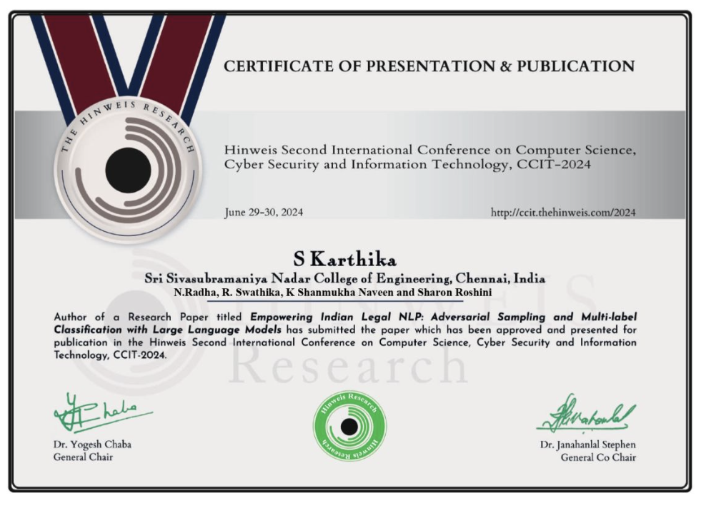

# Empowering Indian Legal NLP: Adversarial Sampling and Multi-label Classification with Large Language Models

Multi-label statute identification on Indian legal text, where a small classification error can change the statutory meaning of a case.

**Published:** Hinweis Second International Conference on Computer Science, Cyber Security and Information Technology (CCIT-2024), June 29–30, 2024. Presented and approved for publication.

**Authors:** S. Karthika, N. Radha, R. Swathika, K. Shanmukha Naveen, Sharon Roshini (Sri Sivasubramaniya Nadar College of Engineering, Chennai)

## What we did

- Built multi-label and multi-class classifiers on a subset of the Indian Legal Statute Identification (ILSI) dataset
- Compared Quantum-BERT (transformer classification with quantum gates), Bi-LSTM, and GRU models with attention
- Tested robustness with adversarial sampling, reaching state-of-the-art results on the dataset

## Repository contents

| File / folder | What it is |
| --- | --- |
| `PAPER_FINAL.pdf` | Conference paper |
| `FYP_FINAL_REPORT_24.pdf` | Full capstone report |
| `FYP_FINAL_REVIEW.pptx` | Final review presentation |
| `FYP.pdf` | Final-year project document |
| `models/` | Quantum-BERT training and test scripts, plus BERT, Bi-LSTM, and GRU notebooks |
| `dataset/` | Train/test splits and the women-related statute subset |
| `CCIT_2024_Certificate.png` | Certificate of presentation and publication |

## Certificate

## Related

- Co-author's repository: [SharonRoshini/LegalNLP](https://github.com/SharonRoshini/LegalNLP)
- Conference: [CCIT-2024](http://ccit.thehinweis.com/2024)
